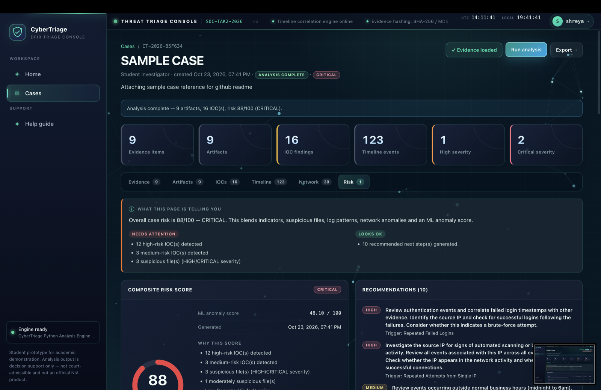
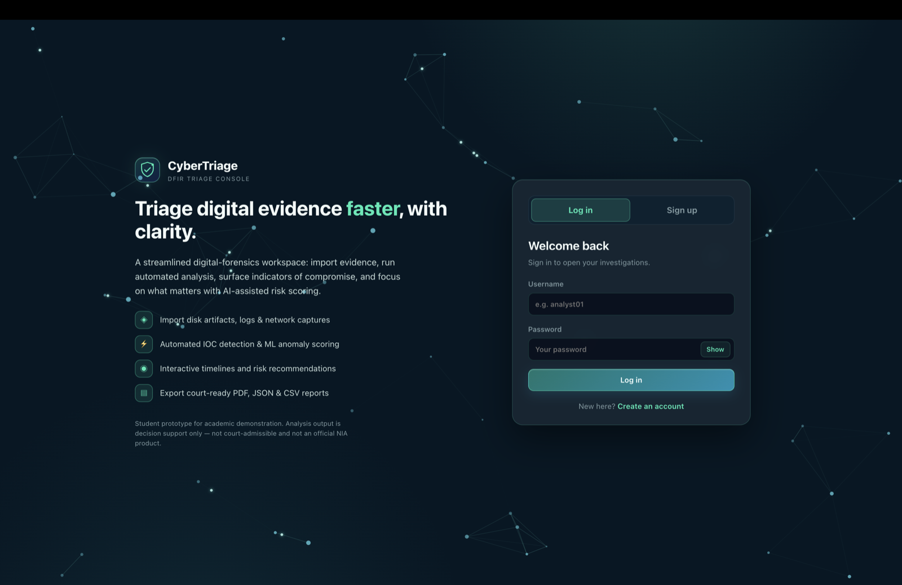
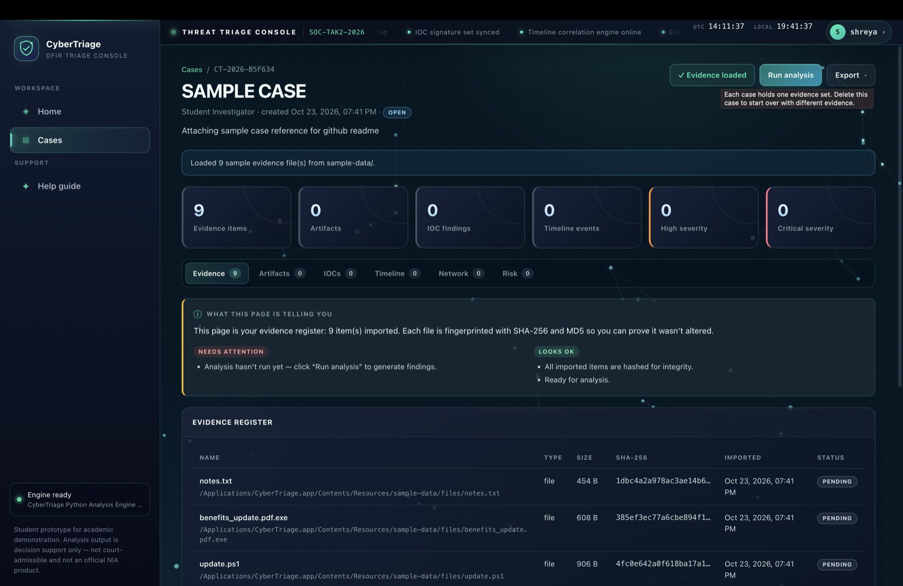
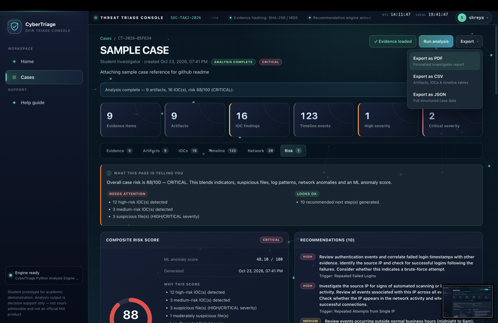
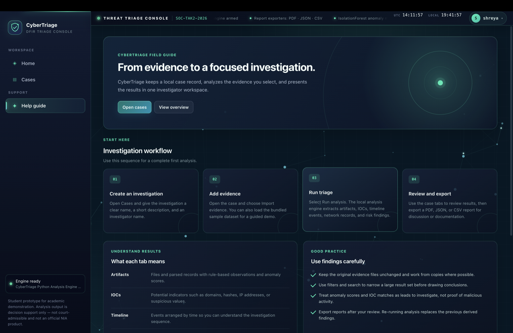
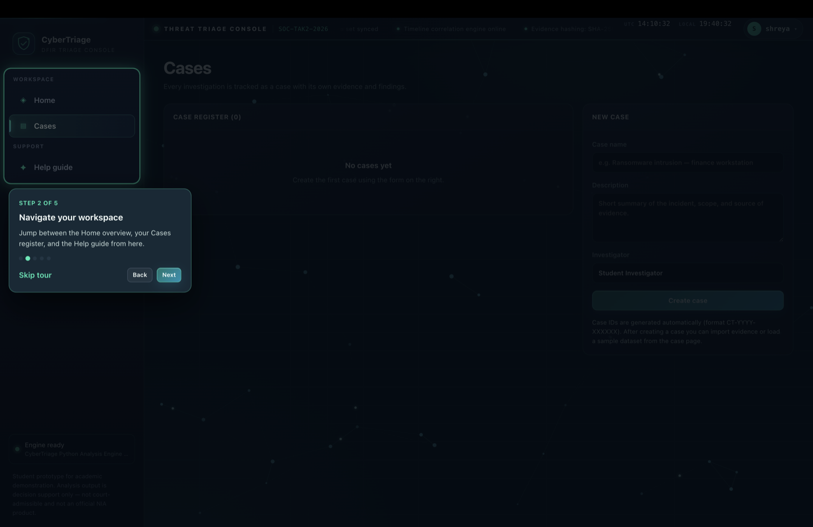
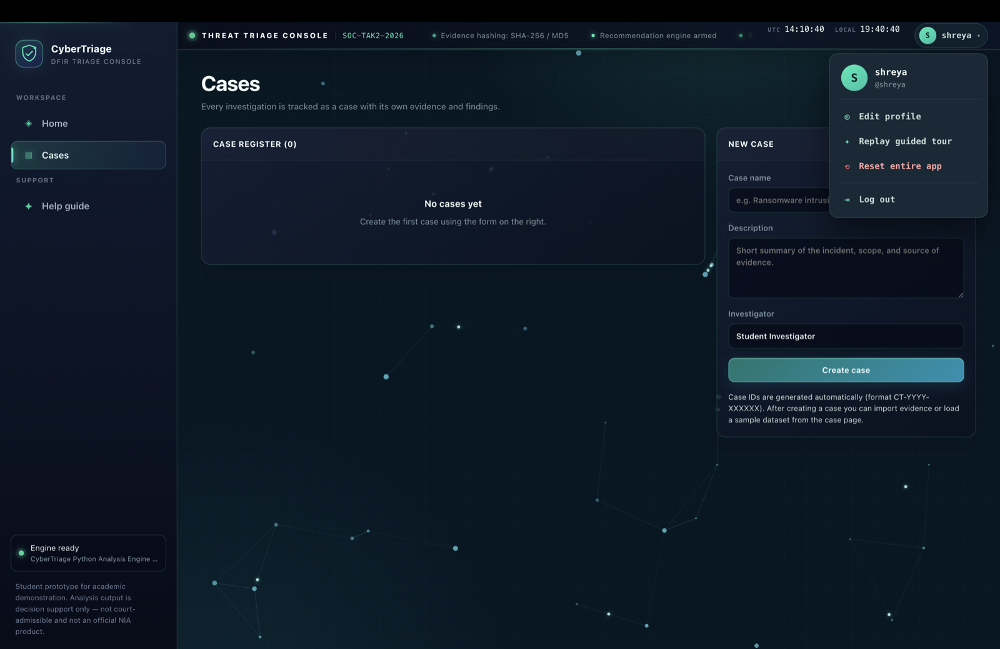
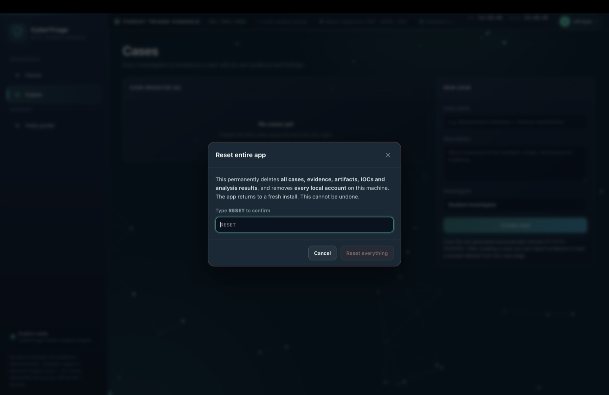

<div align="center">

#  CyberTriage

### A desktop app that turns a pile of raw digital evidence into a clear, ranked threat assessment — in one click.

Sign in → create a case → import evidence (files, **RAW disk images**, or **registry hives**) →
**Run analysis** → get a **0–100 risk score**, the reasons behind it, and what to do next.




</div>

> **Student desktop-development project**, inspired by the **NIA Anti-Cyber Terrorism Division**
> DFIR problem statement. Not an official NIA product; not for court-admissible evidence.
>  Full project guide + live-demo script: **[`Student.md`](Student.md)** ·  Commands: **[`setup.md`](setup.md)**

---

## What it does

When a machine is hacked, an investigator gets a pile of raw material — logs, network records,
suspicious files, even whole disk images. Reading it all by hand is slow. CyberTriage does the
**first fast pass** automatically: it reads the evidence, finds the clues (indicators of
compromise), scores how dangerous the case looks with a **machine-learning model**, and shows a
simple **0–100 risk score** with plain-English reasons and next steps.

-  **Log in / sign up** — each user's cases are private (a new account starts empty).
-  **Import evidence** — files & folders, **RAW disk images** (`.dd`), and **Windows registry hives**.
-  **Analyze automatically** — files, logs, network, registry; extract IOCs (bad IPs/URLs/domains/hashes).
-  **Score with AI/ML** — a real **Isolation Forest** flags unusual artifacts → composite risk + severity.
-  **Review easily** — dashboard, timeline, network map, and a *"what this page is telling you"* box on every screen.
-  **Export** — one button → **PDF / JSON / CSV**.

---

##  Problem-statement coverage

The NIA brief asks for five capabilities. **All five are implemented:**

| # | Requirement | Status | How |
| --- | --- | :---: | --- |
| 1 | Automated collection from **RAW images** (.dd) | Done | Pure-Python **FAT carver** walks the image's filesystem and analyses every file inside |
| 2 | Scan **files, logs, registry, network** | Done | Dedicated parsers for each, incl. **Windows `regf` registry** (Run keys, services) |
| 3 | Identify **IOCs** & suspicious activity | Done | IPs/URLs/domains/hashes + log patterns + network anomalies + bad files |
| 4 | **AI/ML** anomaly detection + scoring + recommendations | Done | **Isolation Forest** → 0–100 composite score + ranked recommendations |
| 5 | **Interactive timelines**, graphical summaries, **PDF/JSON/CSV** | Done | Timeline, dashboard charts, network map; one Export menu → all 3 formats |

---

##  Screenshots

| | |
| :---: | :---: |
|  |  |
| **Login / sign-up gate** | **Case — evidence register (hashed on import)** |
|  |  |
| **Risk tab — score, "why", recommendations** | **One Export menu → PDF / CSV / JSON** |
|  |  |
| **In-app help / field guide** | **First-run guided tour** |
|  |  |
| **Account menu (profile, tour, reset, log out)** | **Reset (type-to-confirm)** |

---

## ▶ Run it

Apple Silicon Mac · Node 20.19+ · Python 3.11

```bash
npm install
python3 -m venv python/venv && python/venv/bin/python3 -m pip install -r requirements.txt
npm run electron:dev
```

Then: **sign up → create a case → Load sample data → Run analysis**.

**Just want the app?** Open `release/CyberTriage-1.0.0-arm64-signed.dmg`, drag it to Applications,
and first-launch with **right-click → Open**. It bundles everything — no Python or Node needed.

> Build the installer yourself: `npm run package:mac-arm64 && npm run resign`. All commands and
> troubleshooting are in **[`setup.md`](setup.md)**.

---

##  Try the demo datasets

Six fake-but-realistic evidence sets in `sample-data/datasets/`, each tuned to a different risk
level (scores are **deterministic**). Load one into a fresh case, then **Run analysis**.

| Dataset | Score | Severity | Shows |
| --- | --- | --- | --- |
| `01-benign-baseline` | 10 / 100 |  LOW | a clean, healthy machine |
| `02-suspicious-insider` | 42 / 100 |  MEDIUM | odd logins + after-hours activity |
| `03-malware-infection` | 71 / 100 |  HIGH | malware, bad IPs, reverse-shell port |
| `04-apt-breach` | 88 / 100 |  CRITICAL | a full targeted intrusion |
| `05-disk-image` | 89 / 100 |  CRITICAL | a **RAW `.dd` image** + a registry hive inside it |
| `06-registry-hive` | 19 / 100 |  LOW | a Windows registry with malicious startup keys |

Best demo order (clean → bad → worst): `01` → `03` → `04`. Lead with `05` to show RAW-image +
registry parsing in one import. Nothing here is a real threat.

---

##  How it's built

Three cooperating layers — the core of a desktop-development project:

| Layer | Tech | Job |
| --- | --- | --- |
| **UI** (face) | React 19 + Vite + Recharts | Screens: dashboard, cases, charts, timeline, network map |
| **Shell** (messenger) | Electron 44 | The desktop window; connects the UI to the OS; runs & supervises the engine |
| **Engine** (brain) | Python 3 (NumPy, ReportLab, python-registry) | Parses evidence, extracts IOCs, runs ML, scores risk, writes reports |

**Desktop-dev concepts shown:** the **main process** (`electron/main.ts`) creates the
`BrowserWindow` on `app.whenReady()` and manages the window lifecycle; a **secure IPC bridge**
(`electron/preload.ts`, `contextBridge` + `contextIsolation`) is the *only* channel between UI and
engine; **native OS integration** via file/save dialogs and reveal-in-Finder; **state &
persistence** in SQLite (cases) + localStorage (accounts); **local AI/ML inference** (no cloud);
and **packaging** with PyInstaller + electron-builder into a signed DMG. *(See [`Student.md`](Student.md) for the file-by-file map.)*

**Data flow:** the UI never runs Python directly — every request goes **React → Electron (preload
→ main) → Python → back**, as one line of JSON each way.

**Where data lives:** cases/evidence/findings in a local **SQLite** file
(`~/Library/Application Support/CyberTriage/cybertriage.db` when installed); accounts in the app's
local storage (passwords **salted + SHA-256 hashed**); reports where you choose. Nothing leaves the
machine; evidence is referenced by path (and hashed), not copied.

---

##  Honest limitations

- **Disk images: FAT only** — raw `.dd`/`.raw`/`.img` are carved; NTFS/ext4 and the compressed **E01** container are future work.
- **Registry: autostart focus** — parses Run/RunOnce keys and services, not every key type.
- **macOS Apple Silicon only**, ad-hoc signed (first open needs right-click → Open), ~134 MB (Electron bundles Chromium).
- **Local accounts** — no cloud/sync/recovery; a convenience, not a hardened security boundary.
- **ML is assistive** — flags statistical oddness, not proven malice; a human decides.

---

##  Disclaimer

CyberTriage is a **student prototype** inspired by the published DFIR problem statement. It is
**not** an official product of the National Investigation Agency (NIA) and must not be used for
real investigations or court-admissible evidence handling. ML-assisted findings indicate
statistical unusualness, **not** confirmed malicious activity.
